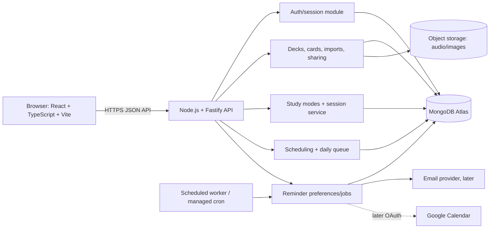

# System Architecture

## Architecture Shape

Start with a **modular monolith**: one React SPA, one Node/Fastify API, and one MongoDB Atlas database. Organize the API by product domain instead of splitting early into microservices. Host audio/images in object storage, not in MongoDB documents.



## Frontend

- **React + TypeScript + Vite**, with React Router for app sections and TanStack Query for API state, caching, and mutations.
- Route areas: `/decks`, `/decks/:deckId`, `/discover`, `/schedule`, `/stats`, `/settings`, and `/study/:deckId/:mode`.
- Feature folders: `features/decks`, `features/cards`, `features/discover`, `features/study`, `features/schedule`, `features/stats`, `features/settings`.
- Shared UI: `components/ui`, `components/layout`, `styles/tokens.css`. Follow the approved Direction E visual in `docs/design/ui-direction-e-approved.svg` and interaction invariants in `docs/UI_PLAN.md`.
- Keep answer hiding, session progress, card modes, and daily goal UI explicit. Client code never decides authorization; the API does.

## Backend

- **Fastify is the backend web framework**, running on Node.js + TypeScript as a REST API. Organize it into `modules/auth`, `modules/decks`, `modules/cards`, `modules/imports`, `modules/sharing`, `modules/study`, `modules/scheduling`, `modules/reminders`, and `modules/stats`.
- Each module has routes/controllers, input schemas, application services, and repository/data access. Keep FSRS and queue allocation in pure domain services that can be unit-tested without HTTP or MongoDB.
- Validate every request and response shape. Derive the acting `userId` from a verified server session/token; never accept it as an authorization fact from the request body.
- Use Better Auth with its MongoDB adapter for email/password, verification, and sessions. Prefer secure, HttpOnly cookies for this browser app; configure trusted origins and CSRF protections for cookie-authenticated mutations. Use a transactional email provider for app-owned email. Better Auth has a documented Fastify integration and Mongo adapter. [Fastify](https://better-auth.com/docs/integrations/fastify), [MongoDB adapter](https://better-auth.com/docs/adapters/mongo)

Fastify is selected over Express or NestJS for this first version: it offers routing, plugins, request/response schemas, and TypeScript support with less application scaffolding than a more opinionated framework. Fastify compiles JSON schemas for validation/serialization. Express is also valid but leaves more structure and middleware choices to the app; NestJS may be worth revisiting if the backend team grows and wants its heavier module/DI conventions. Framework choice will not compensate for missing MongoDB indexes or inefficient queries. [Fastify principles](https://fastify.dev/docs/latest/Reference/Principles/), [Fastify validation/serialization](https://fastify.dev/docs/latest/Reference/Validation-and-Serialization/), [Express](https://expressjs.com/en/)

## MongoDB Data Model

Use one document per card and references between growing collections. Do not embed every card in a deck document: decks may grow, cards need pagination/imports, and review state is private per learner.

| Collection | Contents and key fields |
|---|---|
| `users` | Auth subject, locale, timezone, daily target, new-card cap, reminder settings, enabled deck priorities. Keep secrets/password handling in the selected auth provider. |
| `decks` | `ownerId`, title/description, JLPT, tags, visibility, publication/version state, optional `sourceDeckId` for a downloaded copy. |
| `cards` | `deckId`, `type` (`vocabulary`, `kanji`, `grammar`), sort position, validated type-specific `content`, media object keys. |
| `deckCopies` | User, source deck/version, destination deck, download time; provides traceability without coupling study history to later source edits. |
| `reviewStates` | `userId`, `deckId`, `cardId`, `direction/mode`, FSRS state, `dueAt`, last review. Unique key on `(userId, cardId, direction)`; due lookup index on `(userId, deckId, dueAt)`. |
| `reviewLogs` | Append-only user/card/deck/direction, rating, timestamp, prior/next due, session id. Index by `(userId, reviewedAt)` and `(userId, deckId, reviewedAt)`. |
| `studySessions` | User, selected deck, selected mode, queue item ids, progress/status, timestamps; supports resume/exit without changing the session's deck scope. |

Card `content` should be a discriminated TypeScript union validated at the API boundary and with MongoDB collection validation. Common fields can include prompt, reading, meaning, example, translation, notes, and media; type-specific grammar/kanji fields remain extensible. Add indexes for deck ownership/visibility, deck card pagination, public discovery filters, due review retrieval, and log history.

## Search

- Exact filters and sorting (owner, visibility, JLPT, tags) use MongoDB indexes.
- Add MongoDB Atlas Search for full-text card/deck search, autocomplete, typo tolerance, and relevance ranking if the UI needs them. Its language analyzers include Japanese, including Kuromoji. [MongoDB Search](https://www.mongodb.com/docs/search/about/searching/), [analyzers](https://www.mongodb.com/docs/search/indexes/analyzers/language/)
- Do not introduce Elasticsearch until production measurements or language-search requirements show Atlas Search is insufficient. A second search service means syncing inserts/updates/deletes, reindex recovery, and applying private/public deck permissions consistently in both systems.

## Core Flows and Invariants

1. **Owned deck study:** API verifies access to a deck → gets eligible cards for the selected mode from that deck only → joins the learner's `reviewStates` → creates a session queue → grades each answer through the scheduler → writes a review log and next state.
2. **Daily recommendation:** compute due review units across enabled decks, sort by due/forgetting risk and user priority, then use remaining capacity for new cards. The queue is personalized and scoped to that user. Opening one deck manually bypasses cross-deck mixing but still shows the user's goal remaining.
3. **Shared deck download:** public source remains read-only. Download creates a user-owned copy of deck/card content and separate review state. A source update must not overwrite the copy or its progress.
4. **Atomic grading:** if a review log and state update must commit together, use a MongoDB transaction on a replica set/Atlas deployment; otherwise design idempotent grading to recover safely. MongoDB documents transactions for consistency across collections and notes the deployment requirement/performance tradeoff. [MongoDB transaction guidance](https://www.mongodb.com/docs/manual/data-modeling/enforce-consistency/transactions/)
5. **Media:** API validates upload ownership/type/size and stores files in object storage; card documents contain object keys, not large base64 blobs.

## Suggested Repository Layout

```text
apps/
  web/                 # React + Vite client
  api/                 # Fastify REST API
packages/
  domain/              # Card types, mode eligibility, FSRS adapter, queue rules
  shared/              # API contracts and shared TypeScript types
infra/
  mongodb/             # Index and validation setup scripts
docs/
tests/
```

Start as a pnpm workspace only if the shared domain/contracts package is used by both client and API; otherwise prefer a simpler root app structure. Do not create deployment/worker packages until hosting and reminder delivery are selected.

## Security and Verification Boundaries

- Test private deck access, published-deck reads, copy ownership, and cross-user review isolation at the API/repository boundary.
- Do not trust client-supplied owner ids, due dates, ratings outside the allowed set, or deck visibility changes.
- Keep secrets in environment/secret storage, validate uploads, and rate-limit auth, imports, and public discovery endpoints.
- Vitest: card validation, scheduler transitions, daily queue caps/fairness, duplicate submission handling.
- API integration: account isolation, copy/download behavior, imports, and transactional/idempotent review updates.
- Playwright: sign-in, create deck/card, open deck → select mode → practice only that deck, download shared deck, change locale, configure schedule, desktop/mobile layout.

## Choices Still Open

- MongoDB Atlas region/tier and hosting provider (recommended setup is documented in `docs/DEPLOYMENT_PLAN.md`, not provisioned).
- Auth/session implementation and email verification provider.
- Object storage vendor and signed URL policy.
- Email reminder and Google Calendar integration timing.
- Whether the initial deployment uses separate web/API services or a single host with two processes.
